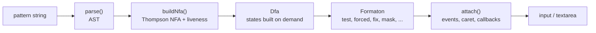
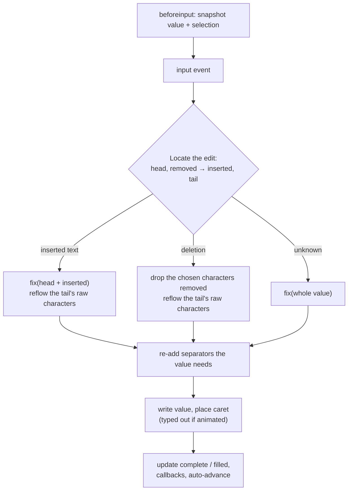

# Architecture

formaton turns the HTML `pattern` attribute into an automaton, then uses it
to help people type. A field like `<input pattern="\(\d{3}\) \d{3}-\d{4}">`
gets separators inserted as you type, a `(___) ___-____` placeholder,
repair for pasted text, and callbacks when the value is valid or full. You
write only the regular expression the browser already validates against.

This document explains how that works, from the regex parser up to the
input event handler, and why it is built this way.

## Contents

- [The big picture](#the-big-picture)
- [Source layout](#source-layout)
- [The engine](#the-engine)
  - [Code point sets](#code-point-sets-charsetts)
  - [Parser](#parser-parserts)
  - [NFA](#nfa-nfats)
  - [Lazy DFA](#lazy-dfa-dfats)
  - [The Formaton API](#the-formaton-api-formatonts)
  - [Lengths and path search](#lengths-and-path-search-pathsts)
- [The DOM binding](#the-dom-binding-domts)
  - [Kinds of fields](#kinds-of-fields)
  - [The input handler](#the-input-handler)
  - [Separators the user may type over](#separators-the-user-may-type-over)
  - [Complete, filled, and moving on](#complete-filled-and-moving-on)
  - [Typing animation](#typing-animation)
  - [Browser quirks](#browser-quirks)
- [Testing](#testing)
- [Build and tooling](#build-and-tooling)
- [Limits](#limits)

## The big picture



Two layers, kept apart on purpose:

- **The engine** (`compile()` and the `Formaton` class) is pure: strings in,
  strings out, no DOM. It runs in Node, so most behaviour is tested there.
- **The DOM binding** (`attach()`) turns browser input events into calls to
  the engine, then writes the result back to the field and moves the caret.

### Why an automaton

The 2014 predecessor, `valex.js`, generated every string a pattern matches
and compared them. That blows up immediately (`\d{10}` has 10¹⁰ matches),
so it collapsed character ranges into single stand-ins and capped the list
at 9999 strings. Both shortcuts caused bugs: separators not inserted when
candidates disagreed, patterns rejected for being "too big".

An automaton answers every question formaton needs, at the position the
user is typing, without listing anything:

| Question | Used for |
| --- | --- |
| Which characters may come next? | rejecting keystrokes, fixing letter case |
| Is exactly one character possible? | inserting separators (`) ` after `(212`) |
| Is the value a complete match? Can it still grow? | green state, auto-advance |
| What is a shortest or longest path to a match? | placeholders, lengths |

## Source layout

| File | Role |
| --- | --- |
| `src/charset.ts` | `CharSet`: immutable sets of Unicode code points, as sorted ranges |
| `src/parser.ts` | Regex parser (`u` and `v` flag syntax) producing an AST |
| `src/nfa.ts` | Thompson construction, guarded `^`/`$` edges, liveness |
| `src/dfa.ts` | Lazy subset construction: deterministic states built as input reaches them |
| `src/paths.ts` | Shortest and longest weighted paths (bucket queue, Tarjan SCC) |
| `src/formaton.ts` | `compile()` and the `Formaton` class: the public engine API |
| `src/range.ts` | `integerRangePattern(lo, hi)`: regex for an integer range |
| `src/errors.ts` | `FormatonSyntaxError`, `FormatonUnsupportedError` |
| `src/dom.ts` | `attach()`, `attachAll()`, `attributeOptions()`, `focusNext()` |
| `src/index.ts` | Package entry: re-exports the above |

The package has no runtime dependencies. TypeScript compiles to ES2020
modules in `dist/`.

## The engine

### Code point sets (`charset.ts`)

Every character class, escape and literal becomes a `CharSet`: a flat,
sorted list of disjoint, non-adjacent inclusive ranges
(`[lo0, hi0, lo1, hi1, ...]`). It supports union, intersection, complement
and difference in linear time, and binary search for membership. `[^0-9]` is
just the complement of `[0-9]` over U+0000 to U+10FFFF: there is no special
"negated" flag anywhere downstream.

### Parser (`parser.ts`)

Browsers compile `pattern` as `^(?:pattern)$` with the `v` (unicodeSets)
flag; older engines used `u`. The parser follows whichever mode `compile()`
picks: `v` where the JS engine supports it, `u` otherwise. It is
recursive descent over code points and produces a small AST:

```ts
type Node =
  | { t: 'set'; set: CharSet }                         // literal, class, escape, '.'
  | { t: 'seq'; items: Node[] }
  | { t: 'alt'; options: Node[] }
  | { t: 'rep'; node: Node; min: number; max: number } // max may be Infinity
  | { t: 'assert'; kind: '^' | '$' };
```

Some details:

- **Validation first.** `compile()` hands the pattern to the native
  `RegExp` before parsing. An invalid pattern throws `FormatonSyntaxError`,
  just as the browser would ignore it. So the parser can be lenient: it
  only ever sees patterns the engine already accepted.
- **Groups disappear.** Capturing does not matter for full-string matching,
  so `(...)`, `(?:...)` and `(?<name>...)` all return their inner node.
- **`v`-mode classes** support nesting, `&&` (intersection), `--`
  (subtraction) and `\q{abc|d}`. Multi-character `\q` strings turn into
  alternatives next to the single-character set.
- **`\p{...}` needs no Unicode tables.** The first time a property is used,
  the parser asks the JS engine which code points match it, by testing each
  one with a native `RegExp`, and caches the resulting `CharSet`. This takes
  roughly 170 ms per property, once.
- **Unsupported features** throw `FormatonUnsupportedError`: backreferences,
  lookahead and lookbehind, `\b`/`\B`, modifier groups `(?i:...)`,
  properties of strings (`\p{RGI_Emoji}`), repetition counts above 10,000.
  None of these can be expressed as a finite automaton (or not cheaply). The
  DOM binding leaves such fields alone.

### NFA (`nfa.ts`)

A standard Thompson construction. Each state has epsilon edges, character
edges (a `CharSet` and a target), and two kinds of guarded epsilon edges:

- `bol` edges, for `^`, which may only be crossed at position 0;
- `eol` edges, for `$`. Once a path crosses one, it may not consume any
  more characters.

Bounded repetition `x{2,5}` unrolls into two required copies followed by a
nested chain of optional copies, `(x(x(x)?)?)?`. That keeps the NFA linear
in the count rather than quadratic. The NFA is capped at 200,000 states.

After construction, a **liveness** pass marks which states can still reach
acceptance. It has two regions: `liveN` (able to reach acceptance while
still consuming characters) and `liveE` (able to reach it with epsilon moves
only, after a `$`). Every later step ignores dead states. That is what makes
"which characters may come next" exact: a character only counts as allowed
if some match can still follow it.

### Lazy DFA (`dfa.ts`)

Determinizing a whole NFA can explode. `[a-z0-9.-]{1,64}@[a-z0-9.-]{1,255}`
has a large DFA, but any one value only ever visits a few dozen of its
states. So deterministic states are built when input first reaches them,
and cached:

- A **`DState`** is the sorted set of live NFA states that have character
  edges, plus an `accept` flag. It is interned by a string key
  (`"A3,7,12"`), so equal sets are the same object.
- **`step(d, cp)`** follows one code point. Results are cached per state.
- **`transitions(d)`** lists every way out of a state. It splits the
  alphabet at every range boundary of the outgoing edges, works out the
  target set for each piece, and merges pieces that lead to the same
  target. The result is a few `{ set, next }` pairs, however large the
  character classes are.
- **`allowed(d)`** is the union of those sets: everything that may come next.

The epsilon closure that builds a state handles the `^`/`$` guards: `bol`
edges are crossed only for the start state, and anything past an `eol` edge
can only make the state accepting, never consume.

### The Formaton API (`formaton.ts`)

`compile(pattern)` returns a `Formaton`. Every method works by walking the
value through the DFA from the start state.

**Matching:** `test()` (full match), `isPrefix()` (can still become a
match), `allowedNext()` (a `CharSet`).

**Forced characters.** A position is *single-choice* when `allowed(d)` has
exactly one member. Two variants matter:

- `forced(value)` gives the run of single-choice characters after `value`,
  stopping once `value` is a complete match. That is what gets appended as
  the user types: `(212` gives `) `, but `12345` gives nothing for
  `\d{5}(-\d{4})?`, because the `-` is optional.
- `autoChars(value)` marks, per character, whether `forced()` would have
  inserted it. It uses the same accept-aware rule, so the optional `-` of a
  ZIP+4 code counts as the user's own character. The DOM binding relies on
  this for deletions and caret placement.

**Raw values.** `unformat(value)` keeps only the characters at positions
with more than one choice (`(212) 555-1234` gives `2125551234`). It counts
every single-choice position as formatting, optional ones included, so a
ZIP+4 code unformats to nine digits. `format(raw)` is its exact inverse.
`minValueLength()` and `maxValueLength()` measure raw values.

**`fix(value, options)`: repairing input.** This is the heart of the
typing help, and it is a search rather than a greedy pass. Each input
character can be:

- taken as is (cost 0);
- taken with its case flipped (cost 1, if `caseFix`);
- dropped (if `drop` is set);

and single-choice characters may be inserted before it (cost 1 each). The
search keeps one best reading per `(position, DState, dangling)`. Here
`dangling` means "the last move was an insertion": such a reading may not
end there, so nothing is ever appended after the last input character.
Among the readings that consume the most input, the winner is the one that:

1. drops the fewest characters;
2. is the input exactly as typed, if that fits;
3. forms a complete match, if any reading does;
4. changes the fewest characters.

Rule 2 keeps `January 202` from being reread as `January 2002`. Rule 3
reads `1212555123` as a raw number for `\+1 \d{10}`, while
`12125551234` keeps its leading `1` as the country code. The result reports
`value`, `ok`, `complete` and `rejected`: the input that did not fit.

**Examples and masks.** `example()` finds a shortest path (breadth-first
over DStates) or a longest one (depth-first, giving up on cycles or more
than 20,000 states) from the current value. It picks a readable character
from each transition: ASCII letters and digits first, then other printable
characters. `mask()` replaces the positions the user must choose with
`_`. A forced letter or digit right after a chosen one is masked too,
because it depends on that choice (the `9` of `(19|20)`); fixed parts at
the start of a group stay, as in `+1 (`, `DE`, `0x`.

### Lengths and path search (`paths.ts`)

`minLength()` and `maxLength()` count UTF-16 code units, as `maxlength`
and `value.length` do, so an astral character weighs 2. They run on the NFA
graph:

- **shortest:** a bucket queue (Dijkstra with small integer weights);
- **longest:** Tarjan's strongly connected components, iteratively. Any
  component with a character edge inside it is a cycle that consumes
  characters, so the length is unbounded (`Infinity`). Otherwise it is a
  longest path over the DAG of components.

`minValueLength()` and `maxValueLength()` use the same two functions on the
explored DFA (at most 50,000 states), with weight 0 for single-choice
positions.

## The DOM binding (`dom.ts`)

`attach(el, options)` reads the pattern from `options.pattern`, then the
element's `pattern` attribute, then a default for its type. Any option can
also come from a `data-formaton-*` attribute on the element, and those win:
the HTML is the most specific place to configure a single field.
`attachAll(root, options)` attaches to every input and textarea, and
accepts a function to give each element its own options.

### Kinds of fields

| `kind` | Fields | What formaton can do |
| --- | --- | --- |
| `text` | text-like inputs with a pattern; `type="email"` (email grammar from the HTML standard) | everything below |
| `number` | `type="number"` with integer `min`/`max`, step 1 | block characters outside the range's alphabet in `beforeinput`; revert digits that cannot lead into range; report filled |
| `native` | `date`, `month`, `week`, `time`, `datetime-local` | report filled only; the browser's widget does the typing |
| `none` | everything else, or an unsupported pattern | nothing |

Number fields get their pattern from `integerRangePattern(min, max)`
(`range.ts`), the classic split into same-length digit ranges. With
`max="12"`, a `2` fills the field but a `1` does not, since `10` to `12`
could follow.

### The input handler

Text fields are handled after the browser has applied an edit, on `input`.
The general approach is "let the browser edit, then repair the result".
`beforeinput` is only used to take a snapshot, not to cancel anything. That
keeps undo, autocorrect, drag and drop and IME input working the browser's
way.



**Locating the edit.** formaton needs to know where the change happened,
in the form `old = head + removed + tail` and `new = head + inserted + tail`.
It tries three sources, in order:

1. the `beforeinput` snapshot of value and selection, if the new value fits it;
2. the caret after the edit. A deletion ends where the caret now is, which
   tells apart which `2` of `22:2` a Backspace removed;
3. comparing the old and new strings for a common prefix and suffix. This
   is the fallback for `type="email"`, which has no caret API.

**Insertion.** The inserted text is placed with `fix(head + inserted)`.

- If nothing that fits got in, the old value and selection are restored and
  `onReject` fires. Only fitting characters ever replace anything.
- If it fits, the rest of the old value is **reflowed from its raw
  characters**: the tail's separators are dropped and re-derived. That makes
  the result independent of where the separators used to be. `editMode`
  decides what happens to the tail: kept (`shift`), the first characters
  replaced one for one (`overwrite`), or cleared (`truncate`). `auto`
  shifts while there is room and overwrites once the field is filled.
- The caret goes after the inserted text, skipping any separators it lands
  in front of, so typing continues at the next choice.

**Deletion.** If the user deleted only separators formaton had inserted,
the next chosen character in that direction goes with them. Otherwise
Backspace on `(212) ` would remove the space only for it to come straight
back. Separators that the value still needs after the deletion are added
back, wherever the caret is. The caret stays where the deletion happened,
and Delete never moves it.

### Separators the user may type over

People type separators out of habit. After `(212` became `(212) `, a typed
`)` or `) ` must not be rejected. But the same tolerance must not swallow a
`1` typed after `+1 (`, where an area code cannot start with 1. So the
binding remembers the separators it just inserted (`pending`), and each may
be typed over once. The typed text has to match the start of that run, or
end exactly at the caret. Moving the caret clears `pending`. Separators
*ahead* of the caret are simply stepped over (`12|:54` plus `:`).

The same idea crosses fields. If formaton typed the last characters
itself (the `M` of `9:30PM`) and auto-advance moved on, the same keys
pressed within 1.5 s are dropped (`carry`) instead of landing in the next
field.

### Complete, filled, and moving on

- **complete:** the value is a valid match (`123` for `\d{3,4}`).
  `onComplete` fires when this becomes true.
- **filled:** complete and nothing more can be typed (`1234`).
  `onFilled` fires when this becomes true, and again when the user re-types
  the last character of a filled value. That is the moment `autoAdvance`
  calls `focusNext()`, but only if the caret is at the end, so finishing an
  edit in the middle does not jump away.

Scripts cannot press Tab, so `focusNext()` reimplements tab order: positive
`tabindex` values first, then document order. It skips disabled, hidden
and inert elements, and the extra buttons of a radio group.

For native date fields, "filled" also requires a year that does not start
with `0`. Chrome reports a half-typed year as `0002-12-31`, `0020-12-31`,
and so on.

### Typing animation

Characters formaton appends at the end (separators, completed words like
`nuary `, a `+1 (` prefix on focus) can be typed out one by one:
15 ms each, at most 200 ms in all. The real value is computed first; the
animation only shows prefixes of it. Any `keydown`, `beforeinput`,
`mousedown` or `blur` finishes it instantly before handling the new event.
So typing never waits, and nothing is lost when someone types faster than
the animation. `onFilled` and auto-advance run when it ends. It is off when
the user prefers reduced motion.

### Browser quirks

| Quirk | What formaton does |
| --- | --- |
| At `maxlength`, browsers swallow keystrokes and truncate pastes without events | `maxlength` is opt-in; formaton enforces length itself |
| `type="email"` has no selection API, and setting its value moves the caret to the end | to place the caret, switch the field to `text` for an instant; leave the caret alone when the value was not changed |
| `type="number"` hides invalid text (`-`, `1e`, Firefox's `1a`) behind `value === ''` | stop characters outside the pattern's alphabet in `beforeinput` |
| Chrome date segments: a typed `00/00/0000` becomes `01/01/0001` on blur | treat years starting with `0` as not filled; recommend `min` |
| IME composition | wait for `compositionend`, then handle it as one insertion |
| Setting `value` from script fires no `input` event and clears Chrome's undo history | documented; frameworks with controlled inputs need to read the value back |

## Testing

| Suite | Runs in | What it covers |
| --- | --- | --- |
| `test/legacy.test.js` | Node | Every pattern from the 2014 `jquery-valium` test page, plus the bugs that page listed |
| `test/api.test.js` | Node | `CharSet`, errors, modes, lengths, masks, `integerRangePattern()` (checked against every integer in range) |
| `test/differential.test.js` | Node | 31 patterns compared with the JS engine's own `RegExp` on about 1,500 generated strings each. It checks `test()`, `isPrefix()`, `forced()`, `fix()`, `unformat()`/`format()` round trips and the length bounds |
| `test/browser/dom.test.js` | Chromium (Playwright) | Real keystrokes against `test/browser/page.html`: typing, pasting, caret placement, every `editMode`, rejection, callbacks, auto-advance, the animation, plus a seeded fuzz test of Backspace and Delete at random positions |

The engine suite runs on every build (`npm test`). The browser suite needs
Chromium (`npm run test:browser`, or `make test-browser` in Docker).

## Build and tooling

- `tsc` compiles `src/` to `dist/` (ES modules plus `.d.ts` type files and
  source maps). That is the whole build.
- The `Makefile` and `Dockerfile` run everything in a container, with
  `node_modules` outside the mounted source tree (`make test`,
  `make test-browser`, `make serve`, `make pack`).
- `scripts/serve.js` serves the demo locally.
- `.github/workflows/pages.yml` publishes the demo to GitHub Pages on every
  push to `master`, after building and running the engine tests.

## Limits

- **No lookaround, backreferences or `\b`.** They cannot be expressed as a
  finite automaton. Such fields get no assistance; the browser still
  validates them.
- **Only single-choice characters are ever inserted.** For the UK postcode
  `[A-Z]{1,2}\d[A-Z\d]? \d[A-Z]{2}`, `M11AE` cannot be fixed: it is only
  clear that `M1` and not `M11` was the first half once it is too late, so
  the user has to type the space.
- **`^` in the middle of a pattern** (`a^b`) is over-approximated: the
  liveness pass treats `^` edges as passable anywhere. This is harmless for
  real patterns.
- **Large patterns** are bounded: 200,000 NFA states, repetition counts up
  to 10,000, 50,000 DFA states for value lengths, 20,000 for longest
  examples. Past those, formaton throws `FormatonUnsupportedError` or falls
  back to the shortest example.
- **Browser coverage.** The DOM binding is tested in Chromium only. Firefox,
  Safari and mobile keyboards (which batch typing into compositions) need
  checking by hand.
